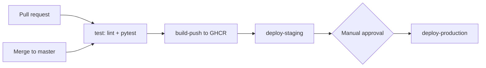

## CI/CD Demo


In this demo, I made a simple API with Flask in order to try to simulate the CI/CD pipeline on corporate enviornments.
The CI/CD pipeline performs actions such as linting, testing with a python script, building a hardened container image, publishing it to GHCR, and ensuring that promotion through staging to production is behind a manual approval gate.

## CI/CD diagram

|Trigger | What runs |
|---|---|
| Pull request | `test` only |
| Push to `master` | `test` → `build-push` → `deploy-staging` → approval → `deploy-production` |
| Tag `v*` | Same as above, plus semver image tags |

## Pipeline stages

| Stage | Tool | What it guards against |
|---|---|---|
| Lint | ruff | Style errors and common bugs reaching `master` |
| Unit tests | pytest + coverage | Regressions in app behavior |
| Image build | Docker multi-stage | Bloated images, build tools shipped to prod |
| Publish | GHCR | Untraceable artifacts (tagged by commit SHA) |
| Approval gate | GitHub Environments | Unreviewed production deploys |

## Run locally

```powershell
python -m pip install -r requirements.txt -r requirements-dev.txt
python -m ruff check .
python -m pytest
```
copy .env.example .env

Create secrets/db_password.txt
```powershell
mkdir secrets
-join ((48..57)+(65..90)+(97..122) | Get-Random -Count 32 | ForEach-Object {[char]$_}) | Set-Content -NoNewline secrets\db_password.txt
```

```powershell
docker compose up -d --build --wait
```

