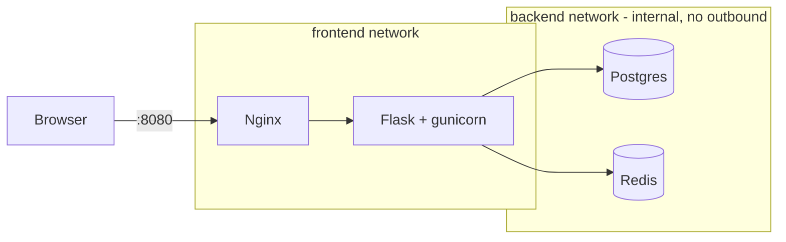
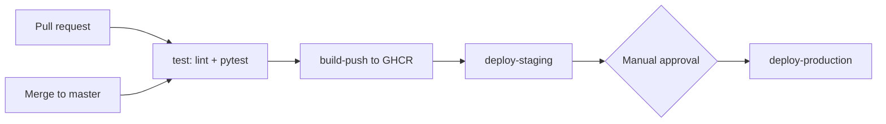

## DevOps-notes-platform


A small Flask notes API with a CI/CD pipeline and a hardened multi-service Docker Compose stack. The API is really simple as I have mainly used this project to learn more about the DevOps side of development.

The CI/CD pipeline follows good practices, as it performs actions such as linting, testing with a python script, building a hardened container image, publishing it to GHCR, and ensuring that promotion through staging to production is behind a manual approval gate.

## Architecture



Only Nginx publishes a port. Postgres and Redis are reachable only from the `api` container over an `internal` network.

## CI/CD diagram

|Trigger | What runs |
|---|---|
| Pull request | `test` only |
| Push to `master` | `test` → `build-push` → `deploy-staging` → approval → `deploy-production` |
| Tag `v*` | Same as above, plus semver image tags |

## Pipeline stages

| Stage | Tool | What it guards against |
|---|---|---|
| Lint | ruff | Style errors and common bugs reaching `master` |
| Unit tests | pytest + coverage | Regressions in app behavior |
| Image build | Docker multi-stage | Bloated images, build tools shipped to prod |
| Publish | GHCR | Untraceable artifacts (tagged by commit SHA) |
| Approval gate | GitHub Environments | Unreviewed production deploys |


## Hardened container image

| Control | Where | What it prevents |
|---|---|---|
| Non-root user (uid 10001) | Dockerfile | Root inside the container if the app is compromised |
| Multi-stage build | Dockerfile | Build tools and pip caches shipped in the image |
| Read-only root filesystem + tmpfs | Compose | Tampering with binaries, dropping files |
| `cap_drop: ALL` + minimal `cap_add` | Compose | Unneeded Linux capabilities |
| `no-new-privileges` | Compose | Privilege escalation via setuid binaries |
| CPU, memory, PID limits | Compose | A runaway service starving the others, fork bombs |
| Internal backend network | Compose | DB and cache reaching the internet or being reached from outside |
| No published DB/cache ports | Compose | Direct access from the host or network |
| File-based secrets | Compose | Password visible in `docker inspect` or the process environment |
| Parameterized SQL | App | SQL injection |
| Least-privilege workflow `permissions` | CI | Over-powered pipeline token |

**Known limitations:** secrets are plaintext files on the host, not encrypted (Vault is planned) and Redis persistence is disabled by design.

The hardened disk image is also significantly lighter than a regular python image, since python:3.15 includes pip caches and build tooling.

| Image | Disk usage |
|---|---|
| Hardened Alpine image | 125MB |
| python:3.15 image | 1.71GB |

## Persistence, backup and restore

- Data lives in the `pgdata` named volume. Thus, a note survives `down` / `up` and disappears after `down -v` (`<docs/persistence.png>`).
- Backup: `.\scripts\backup.ps1` writes a `pg_dump` custom-format file to `backups\`.
- Restore: `.\scripts\restore.ps1 -File backups\<file>.dump`

## Quick start

```powershell
copy .env.example .env
mkdir secrets
-join ((48..57)+(65..90)+(97..122) | Get-Random -Count 32 | ForEach-Object {[char]$_}) | Set-Content -NoNewline secrets\db_password.txt
docker compose up -d --build --wait
curl.exe localhost:8080/ready
```

| Endpoint | Purpose |
|---|---|
| `GET /health` | Liveness: process is up (touches no dependencies) |
| `GET /ready` | Readiness: Postgres and Redis reachable |
| `GET /visits` | Redis counter |
| `GET /notes`, `POST /notes` | Notes stored in Postgres |

Stop with `docker compose down` (keeps data) or `docker compose down -v` (deletes the volume).

## Roadmap

- [ ] Real deployment via Kubernetes and Argo CD
- [ ] DevSecOps gates: Gitleaks, Semgrep, Trivy, SBOM, Cosign signing
- [ ] Connection pooling, Vault for secrets
- [ ] Dependabot for actions, pip, Docker